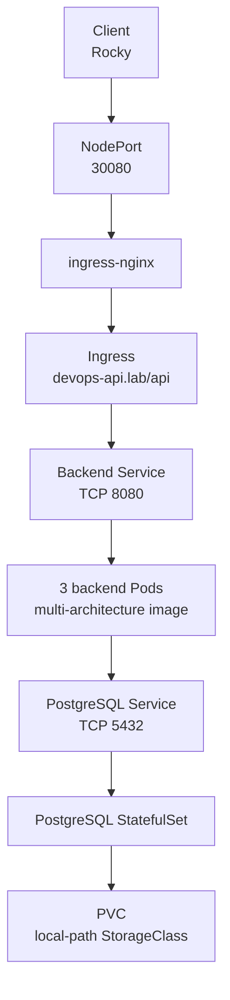

# devops-api-stack on Kubernetes

This directory contains the integrated Kubernetes deployment of the
`devops-api-stack`.

Unlike the other directories under `kubernetes/`, which contain isolated
learning exercises, this package combines the concepts studied during the CKA
phase into a complete application deployment.

## Architecture



## Components

| Component | Kubernetes resource | Purpose |
|---|---|---|
| Application namespace | Namespace | Isolates the application resources |
| Application configuration | ConfigMap | Stores non-sensitive application settings |
| Database credentials | Secret | Stores the PostgreSQL username and password outside Git |
| Backend | Deployment | Runs three replicas of the Python API in the lab overlay |
| Backend networking | ClusterIP Service | Provides a stable endpoint for the backend Pods |
| Database | StatefulSet | Runs PostgreSQL with persistent storage |
| Database networking | ClusterIP and headless Services | Provides application access and stable StatefulSet identity |
| Storage | PVC and local-path StorageClass | Dynamically provisions persistent database storage |
| External routing | Ingress | Routes `/api` requests for `devops-api.lab` |
| Cluster entry point | ingress-nginx NodePort | Exposes HTTP on port `30080` |
| Network security | NetworkPolicy | Restricts communication between components |
| GitOps deployment | Argo CD Application | Keeps the cluster aligned with the `master` branch |

## Tested environment

The deployment is tested on a mixed-architecture kubeadm cluster:

| Node | Architecture | Role |
|---|---|---|
| Ubuntu control plane | AMD64 | Kubernetes control plane |
| Raspberry Pi worker | ARM64 | Application workloads |

The backend image is published to GitHub Container Registry with support for:

- `linux/amd64`
- `linux/arm64`

## Prerequisites

The following components must be available before deploying the application:

- Kubernetes 1.35 or compatible;
- `kubectl` with Kustomize support;
- Helm;
- a CNI that enforces Kubernetes NetworkPolicy, in this case Calico;
- Rancher Local Path Provisioner;
- ingress-nginx;
- Argo CD.

Verify the cluster components:

```bash
kubectl get nodes

kubectl -n kube-system get \
  daemonset/calico-node \
  deployment/calico-kube-controllers

kubectl -n local-path-storage get \
  deployment/local-path-provisioner
```

## Install the StorageClass

The application expects a StorageClass named `local-path` using the existing
Local Path Provisioner:

```bash
kubectl apply \
  -f prerequisites/local-path-storageclass.yaml

kubectl get storageclass local-path
```

If the provisioner is not installed, the PostgreSQL PVC will remain
`Pending`.

## Install ingress-nginx

Add the official Helm repository:

```bash
helm repo add ingress-nginx \
  https://kubernetes.github.io/ingress-nginx

helm repo update
```

Install the pinned chart version with the project values:

```bash
helm upgrade --install ingress-nginx \
  ingress-nginx/ingress-nginx \
  -n ingress-nginx \
  --create-namespace \
  --version 4.15.1 \
  --values prerequisites/ingress-nginx-values.yaml
```

The controller is exposed using:

- HTTP NodePort: `30080`
- HTTPS NodePort: `30443`

The application currently uses HTTP only. Port `30443` is reserved for a
future TLS configuration.

## Configure the PostgreSQL credentials

Create the local secret source from the provided example:

```bash
cp \
  overlays/lab/secrets.env.example \
  overlays/lab/secrets.env

chmod 600 overlays/lab/secrets.env
```

Edit the file and replace the example password:

```dotenv
DB_USER=devops_api
DB_PASS=replace-with-a-strong-password
```

The file is ignored by Git and must never be committed. Create the namespace
and the Secret directly in the cluster:

```bash
kubectl create namespace devops-api \
  --dry-run=client \
  -o yaml | kubectl apply -f -

kubectl -n devops-api create secret generic postgres-credentials \
  --from-env-file=overlays/lab/secrets.env \
  --dry-run=client \
  -o yaml | kubectl apply -f -
```

The Secret keeps the stable name `postgres-credentials`. It is required by the
backend and PostgreSQL, but it is not managed by Git or Argo CD.

## Validate the manifests

Render the manifests before applying them:

```bash
kubectl kustomize overlays/lab
```

Perform server-side validation:

```bash
kubectl apply -k overlays/lab --dry-run=server
```

## Deploy with Argo CD

GitHub Actions and Argo CD have different responsibilities:

- GitHub Actions validates the project and publishes container images;
- Argo CD deploys the manifests and reconciles the cluster state.

The Argo CD Application follows:

- branch: `master`;
- path: `kubernetes/devops-api-stack/overlays/lab`.

Automatic sync, pruning and self-healing are enabled. After a change is merged
into `master`, Argo CD detects it and applies the new desired state.

Bootstrap the AppProject and Application once:

```bash
kubectl apply -k argocd

kubectl -n argocd get \
  appproject/devops-api-stack \
  application/devops-api-stack
```

Follow the first reconciliation:

```bash
kubectl -n argocd get \
  application/devops-api-stack \
  -w
```

When the Application reports `Synced` and `Healthy`, confirm the workloads:

```bash
kubectl -n devops-api rollout status \
  statefulset/postgres

kubectl -n devops-api rollout status \
  deployment/backend
```

## Verify the deployment

```bash
kubectl -n devops-api get \
  deployment,statefulset,pod,service,pvc,ingress,networkpolicy \
  -o wide
```

Expected state:

- PostgreSQL StatefulSet: `1/1`;
- backend Deployment: `3/3`;
- PostgreSQL PVC: `Bound`;
- Ingress host: `devops-api.lab`;
- backend and PostgreSQL Pods: no unexpected restarts.

## Access the API

The simplest test does not require local DNS configuration:

```bash
curl \
  -H 'Host: devops-api.lab' \
  http://192.168.1.163:30080/api/live
```

To use the hostname directly, add the worker address to the client hosts file:

```text
192.168.1.163 devops-api.lab
```

The API is then available at:

```text
http://devops-api.lab:30080/api
```

## Endpoints

| Endpoint | Purpose |
|---|---|
| `/api/live` | Confirms that the backend process is alive |
| `/api/ready` | Confirms that the backend can reach PostgreSQL |
| `/api/health` | Reports database connectivity |
| `/api/version` | Returns the application version |
| `/api/visits` | Increments and returns the persistent visit counter |
| `/api/reset` | Resets the visit counter |
| `/api/whoami` | Returns the responding backend Pod identity |
| `/api/metrics` | Returns application request and uptime metrics |
| `/api/help` | Lists the available operations |

Examples:

```bash
curl http://devops-api.lab:30080/api/live
curl http://devops-api.lab:30080/api/ready
curl http://devops-api.lab:30080/api/visits
curl http://devops-api.lab:30080/api/whoami
```

## Health probes

The backend exposes internal probe endpoints without the public `/api`
prefix:

| Probe | Path | Purpose |
|---|---|---|
| Startup | `/live` | Allows the application time to initialise |
| Readiness | `/ready` | Removes Pods from the Service when PostgreSQL is unavailable |
| Liveness | `/live` | Restarts an unresponsive backend process |

The Ingress only exposes `/api`, so the internal probe paths are not publicly
routed.

PostgreSQL uses `pg_isready` for startup, readiness and liveness checks.

## Persistent storage

PostgreSQL runs as a StatefulSet and uses a dynamically provisioned PVC:

```text
data-postgres-0
```

The `local-path` StorageClass uses:

```yaml
volumeBindingMode: WaitForFirstConsumer
reclaimPolicy: Delete
```

`WaitForFirstConsumer` allows Kubernetes to provision the volume on the node
selected for the PostgreSQL Pod.

## Network security

The package applies three NetworkPolicies.

### PostgreSQL ingress

Only backend Pods may connect to PostgreSQL on TCP port `5432`.

### Backend ingress

Only the ingress-nginx controller may connect to backend Pods on TCP port
`8080`.

### Backend egress

Backend Pods may connect only to:

- PostgreSQL on TCP port `5432`;
- CoreDNS on UDP/TCP port `53`.

## Container security

The backend container:

- runs as UID/GID `10001`;
- runs as a non-root user;
- uses a read-only root filesystem;
- disables privilege escalation;
- does not mount a Kubernetes ServiceAccount token;
- drops all Linux capabilities;
- uses the runtime-default seccomp profile.

PostgreSQL:

- runs as UID/GID `999`;
- uses an `fsGroup` for persistent volume ownership;
- disables privilege escalation;
- drops all Linux capabilities;
- uses the runtime-default seccomp profile.

## Image updates

The lab overlay pins the backend to a commit-specific image tag.

To deploy another validated build:

1. Confirm that the image supports both AMD64 and ARM64:

   ```bash
   docker buildx imagetools inspect \
     ghcr.io/limonne/devops-api-stack:sha-COMMIT
   ```

2. Update `newTag` in `overlays/lab/kustomization.yaml` on a feature branch.

3. Commit the change, push the branch and merge the pull request after CI
   succeeds.

4. Argo CD detects the change in `master` and performs the rollout.

## Continuous integration

GitHub Actions validates:

- Python syntax and lint;
- Docker Compose configuration;
- Docker image build;
- Docker Compose health checks;
- YAML files in this package;
- Kustomize rendering for the base and lab overlay;
- secret-file hygiene;
- multi-architecture image publication to GHCR when image-related files
  change.

The workflow also confirms that `secrets.env` is not tracked. Real credentials
are never uploaded to GitHub.

GitHub Actions does not deploy the application. Deployment is handled by Argo
CD after the validated change reaches `master`.

## Troubleshooting

### PostgreSQL PVC remains Pending

Check the StorageClass and provisioner:

```bash
kubectl get storageclass local-path

kubectl -n local-path-storage get deployment/local-path-provisioner

kubectl -n devops-api describe pvc/data-postgres-0
```

### Backend is not Ready

Check the backend logs and PostgreSQL connectivity:

```bash
kubectl -n devops-api logs deployment/backend

kubectl -n devops-api get pod postgres-0
```

### Ingress returns 404

Confirm that the correct host and `/api` prefix are being used:

```bash
curl -H 'Host: devops-api.lab' \
  http://192.168.1.163:30080/api/live
```

Inspect the Ingress:

```bash
kubectl -n devops-api describe ingress devops-api
```

### DNS resolution fails after applying NetworkPolicy

Confirm that CoreDNS is running and that `allow-backend-egress` exists:

```bash
kubectl -n kube-system get pods -l k8s-app=kube-dns

kubectl -n devops-api get networkpolicy/allow-backend-egress
```

### Argo CD does not report Synced

Inspect the Application conditions and the repo-server logs:

```bash
kubectl -n argocd get \
  application/devops-api-stack \
  -o yaml

kubectl -n argocd logs \
  deployment/argocd-repo-server \
  --tail=50
```

Also confirm that `postgres-credentials` exists before expecting the workloads
to become Ready:

```bash
kubectl -n devops-api get secret/postgres-credentials
```

## Removal

Delete the Argo CD Application first so it does not recreate resources while
they are being removed:

```bash
kubectl -n argocd delete \
  application/devops-api-stack

kubectl -n argocd delete \
  appproject/devops-api-stack

kubectl delete namespace devops-api
```

> **Warning:** deleting the Namespace also deletes the PVC and
> dynamically provisioned PostgreSQL volume. The stored database data may be
> permanently lost.

Cluster-level prerequisites are managed separately. Remove ingress-nginx only
when it is no longer used by other applications:

```bash
helm uninstall ingress-nginx -n ingress-nginx
```

## GitOps environments and release checks

The application has three environments in the same lab cluster.
Each environment has its own Argo CD Application, namespace, PostgreSQL
workload and Ingress hostname.

| Environment | Overlay | Namespace | Argo CD Application |
| --- | --- | --- | --- |
| Lab | `overlays/lab` | `devops-api` | `devops-api-stack` |
| Staging | `overlays/staging` | `devops-api-staging` | `devops-api-stack-staging` |
| Production lab | `overlays/production` | `devops-api-production` | `devops-api-stack-production` |

All Applications follow `master` in this repository.
The paths above are relative to `kubernetes/devops-api-stack/`.

GitHub Actions validates the code and manifests, and publishes images when
image-related files change or a release tag is pushed. Argo CD monitor the
configured Git paths and deploys the desired state.

### Secrets

The `postgres-credentials` Secret is created directly in each environment
namespace before the first deployment. The workloads reference this Secret
by name.

The overlays do not generate it. The local `secrets.env` file stays outside
Git, and the credentials are not included in the rendered manifests.
Argo CD cannot recreate this Secret from the application manifests if it
is missing.

### Deployment order

Sync waves organise the resources within the Sync phase.
Lower wave numbers are applied first.

| Wave | Resources |
| --- | --- |
| `-2` | Application ConfigMap and both PostgreSQL Services |
| `-1` | PostgreSQL StatefulSet |
| `0` | Backend Deployment, backend Service and NetworkPolicies |
| `1` | Ingress |

The PostSync check runs after the Sync phase and waits for the application
resources to become Healthy. Its phase determines when it runs, even if
the hook has the default wave.

The AppProject must allow the hook's resource type:

```yaml
namespaceResourceWhitelist:
  - group: batch
    kind: Job
```

This entry belongs under `spec` in the AppProject and is added alongside
the resource types already permitted.

### PostSync API check

The `backend-release-check` Job calls the API through the Ingress
Controller, using the hostname configured for that environment.

| Endpoint | Expected response |
| --- | --- |
| `/api/live` | `status` is `alive` |
| `/api/ready` | `database` is `OK` |
| `/api/version` | `version` matches `EXPECTED_VERSION` |

Each overlay defines `INGRESS_URL`, `API_HOST` and `EXPECTED_VERSION` in
`release-check-config.yaml`.

The Job uses the same application image as the backend. Its
`BeforeHookCreation` policy removes the previous hook before creating a
new one. Logs remain available until that replacement.

A failed PostSync check marks the sync operation as failed. The application
resources can still be Synced and Healthy because these states describe
different checks. A PostSync failure does not automatically roll back the
workloads.

### Promote the same image

Promote a release by updating the image digest in each overlay, starting
with lab, then staging, then the production lab.

Use the complete digest from the beginning of this command's output:

```bash
docker buildx imagetools inspect \
  ghcr.io/limonne/devops-api-stack:sha-12e1686
```

For each promotion:

1. Update the target overlay with the approved digest.
2. Render the overlay and check the diff.
3. Commit, push and merge the pull request into `master`.
4. Wait for the corresponding Argo CD Application and PostSync check.
5. Confirm success before promoting to the next environment.

Reuse the approved image without rebuilding it for each environment.
Publishing an image alone does not update a pinned digest in Git.

The Applications sync independently. This promotion order is followed
through separate pull requests; a staging failure does not automatically
block another Application from syncing.

### Validate a release

Run these commands from the repository root:

```bash
for application in \
  devops-api-stack \
  devops-api-stack-staging \
  devops-api-stack-production; do

  printf '\n--- %s ---\n' "$application"

  kubectl -n argocd get application "$application" -o json |
    jq '{
      revision: .status.sync.revision,
      sync: .status.sync.status,
      health: .status.health.status,
      operationRevision: .status.operationState.syncResult.revision,
      operation: .status.operationState.phase
    }'
done
```

Confirm `Synced`, `Healthy` and `Succeeded`. Also check that `revision`
and `operationRevision` match the merged commit being validated.

Read the hook logs for each environment:

```bash
for namespace in \
  devops-api \
  devops-api-staging \
  devops-api-production; do

  printf '\n--- %s ---\n' "$namespace"
  kubectl -n "$namespace" logs job/backend-release-check
done
```

The expected final message is `PostSync API check OK`.

## Application monitoring

The backend exposes Prometheus metrics on port 9091 at `/metrics`.

The existing `/api/metrics` endpoint continues to return application
information in JSON.

The application metrics include:

- `devops_api_http_requests_total`: completed API GET requests,
  grouped by endpoint and HTTP status;
- `devops_api_http_request_duration_seconds`: measure of requests duration.

Prometheus discovers and scrapes each backend Pod in the lab namespace.
RBAC permits Pod discovery, and a NetworkPolicy permits access from
Prometheus to the metrics port.

The monitoring manifests include Prometheus, Node Exporter and
kube-state-metrics. Prometheus uses persistent storage.

Apply the monitoring configuration from the repository root:

```bash
kubectl apply -k kubernetes/devops-api-stack/monitoring
```

The application is deployed by Argo CD. The monitoring configuration
is applied separately with Kustomize.

Example PromQL queries:

```promql
up{job="devops-api"}
```

```promql
sum(
  rate(
    devops_api_http_requests_total{
      job="devops-api",
      endpoint="/visits"
    }[5m]
  )
)
```

The request metrics also include Kubernetes liveness and readiness
probes.

### References

- [Argo CD sync phases and waves](https://argo-cd.readthedocs.io/en/stable/user-guide/sync-waves/)
- [Argo CD automated sync](https://argo-cd.readthedocs.io/en/stable/user-guide/auto_sync/)
- [Docker image digests](https://docs.docker.com/dhi/explore/security-concepts/digests/)


## Current limitations

This project aims to be a realistic laboratory deployment, not a production
database platform.

Current limitations are deliberate:

- one PostgreSQL replica without high availability;
- node-local persistent storage;
- HTTP without TLS;
- NodePort instead of a cloud load balancer;
- PostgreSQL credentials created manually in the cluster;
- no automated database backup;
- no external Secret management.

These areas will evolve during the observability and AWS phases.
