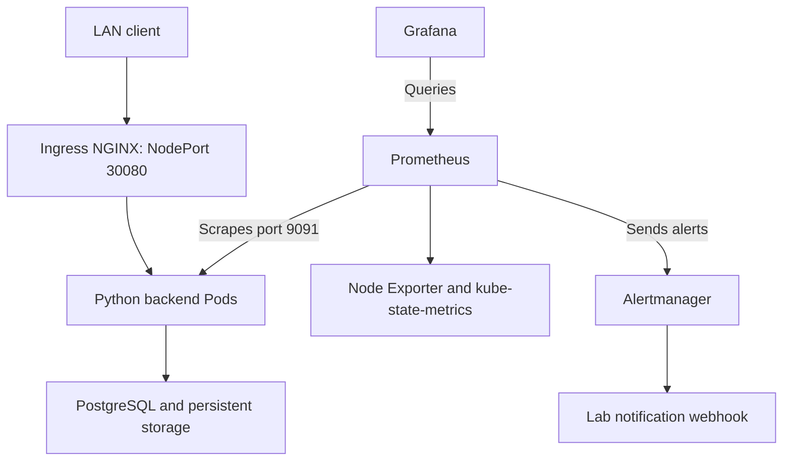

# devops-api-stack on Kubernetes

This package brings together the Kubernetes, GitOps and observability work
for the `devops-api-stack` project.

The Python API uses PostgreSQL for persistent data. Argo CD manages the
application environments. Prometheus collects metrics, Grafana displays
them, and Alertmanager routes notifications to a laboratory webhook.

This is a learning project running on a mixed-architecture Kubernetes
cluster.

**Run all shell commands in this guide from the repository root.**

## Architecture



The application Ingress routes `/api` requests to the backend on port 8080.
Prometheus scrapes each backend Pod separately on port 9091.

## Repository structure

Paths in this table are relative to `kubernetes/devops-api-stack/`.

| Directory | Purpose |
| --- | --- |
| `base/` | Shared application workloads, configuration and policies |
| `overlays/lab/` | Lab environment, Ingress and metrics access policy |
| `overlays/staging/` | Staging environment |
| `overlays/production/` | Production lab environment |
| `argocd/` | Argo CD project and application definitions |
| `monitoring/` | Monitoring workloads, configuration, rules and RBAC |
| `monitoring/dashboards/` | Grafana dashboard JSON files |
| `monitoring/scripts/` | Application traffic script |
| `prerequisites/` | StorageClass and ingress-nginx values |

## Laboratory environment

| Node | Operating system | Architecture | Address |
| --- | --- | --- | --- |
| `k8s-control-plane` | Ubuntu | AMD64 | `192.168.122.83` |
| `k8s-worker-01` | Debian on Raspberry Pi | ARM64 | `192.168.1.163` |

The cluster uses Kubernetes 1.35, containerd, Calico and the Local Path
Provisioner. The backend image is published to GHCR for AMD64 and ARM64.

### Hostname resolution

The examples use `k8s-worker-01`. This name must resolve on each client,
including the Rocky VM and the Windows workstation.

Use local DNS or add this entry to the client's hosts file:

```text
192.168.1.163 k8s-worker-01 devops-api.lab
```

On Linux, the file is `/etc/hosts`. On Windows, it is
`C:\Windows\System32\drivers\etc\hosts`.

The Kubernetes node name does not automatically create a DNS record for
external clients. The `devops-api.lab` alias also permits browser access
to the application through its Ingress host.

Monitoring interfaces are accessed through the worker hostname and
NodePorts. They do not require a running port-forward or SSH tunnel.

| Component | Lab address |
| --- | --- |
| Prometheus | <http://k8s-worker-01:30900> |
| Grafana | <http://k8s-worker-01:30300> |
| Alertmanager | <http://k8s-worker-01:30903> |
| Argo CD, configured separately | <https://k8s-worker-01:30443> |

The application uses port `30080` with the appropriate Ingress Host header.

## Prerequisites

Before deploying, the cluster needs:

- `kubectl` with Kustomize support;
- Helm;
- Calico or another CNI that enforces NetworkPolicies;
- the Local Path Provisioner;
- ingress-nginx;
- Argo CD.

Local validation commands also use Docker, Python 3, Git and `jq`.

Check the cluster and storage provisioner:

```bash
kubectl config current-context
kubectl get nodes -L kubernetes.io/arch
kubectl -n kube-system get daemonset/calico-node
kubectl -n local-path-storage get deployment/local-path-provisioner
```

Create the StorageClass using the existing provisioner:

```bash
kubectl apply \
  -f kubernetes/devops-api-stack/prerequisites/local-path-storageclass.yaml

kubectl get storageclass local-path
```

Install ingress-nginx with the project values:

```bash
helm repo add ingress-nginx \
  https://kubernetes.github.io/ingress-nginx

helm repo update

helm upgrade --install ingress-nginx \
  ingress-nginx/ingress-nginx \
  --namespace ingress-nginx \
  --create-namespace \
  --version 4.15.1 \
  --values kubernetes/devops-api-stack/prerequisites/ingress-nginx-values.yaml
```

The ingress-nginx Service exposes HTTP on `30080` and HTTPS on `30443`.
Argo CD installation and its access configuration are cluster prerequisites
managed separately from this application package.

## Application environments

Each environment has its own namespace, PostgreSQL workload, Ingress and
Argo CD Application. The production environment is part of the lab cluster.

| Environment | Namespace | Argo CD Application | Ingress host |
| --- | --- | --- | --- |
| Lab | `devops-api` | `devops-api-stack` | `devops-api.lab` |
| Staging | `devops-api-staging` | `devops-api-stack-staging` | `devops-api.staging.lab` |
| Production lab | `devops-api-production` | `devops-api-stack-production` | `devops-api.production.lab` |

All three Applications follow `master` and their corresponding directories
under `kubernetes/devops-api-stack/overlays/`.

The lab overlay runs three backend replicas. Application metrics are
currently collected from the lab namespace.

## Secrets

Secrets are created directly in the cluster and referenced by name.
They are not generated by the application overlays or committed to Git.

### PostgreSQL credentials

When preparing the lab environment for the first time:

```bash
cp \
  kubernetes/devops-api-stack/overlays/lab/secrets.env.example \
  kubernetes/devops-api-stack/overlays/lab/secrets.env

chmod 600 kubernetes/devops-api-stack/overlays/lab/secrets.env

vim kubernetes/devops-api-stack/overlays/lab/secrets.env
```

The local file contains `DB_USER` and `DB_PASS`. Replace the example values
before creating the Secret.

```bash
kubectl create namespace devops-api \
  --dry-run=client -o yaml |
  kubectl apply -f -

kubectl -n devops-api create secret generic postgres-credentials \
  --from-env-file=kubernetes/devops-api-stack/overlays/lab/secrets.env \
  --dry-run=client -o yaml |
  kubectl apply -f -
```

Create a Secret named `postgres-credentials` in the staging and production
namespaces before their first deployment, using the credentials chosen for
each environment.

`secrets.env` stays outside Git. Argo CD cannot recreate these credentials
from the committed application manifests.

### Grafana administrator

For the first deployment, create the monitoring namespace and the Secret
used to initialise the Grafana administrator account:

```bash
kubectl create namespace monitoring-lab \
  --dry-run=client -o yaml |
  kubectl apply -f -

read -r -s -p 'Grafana admin password: ' GRAFANA_ADMIN_PASSWORD
printf '\n'

kubectl -n monitoring-lab create secret generic grafana-admin \
  --from-literal=admin-password="$GRAFANA_ADMIN_PASSWORD" \
  --dry-run=client -o yaml |
  kubectl apply -f -

unset GRAFANA_ADMIN_PASSWORD
```

Use the existing account password when Grafana already has an initialised
database. Updating the bootstrap Secret does not rotate that account's
stored password.

## Deploy the application with Argo CD

GitHub Actions validates the project and publishes images. Argo CD deploys
the application and reconciles its state with Git.

Render the manifests:

```bash
for environment in lab staging production; do
  kubectl kustomize \
    "kubernetes/devops-api-stack/overlays/$environment" \
    > "/tmp/devops-api-$environment.yaml"
done
```

Bootstrap the Argo CD configuration:

```bash
kubectl apply -k kubernetes/devops-api-stack/argocd

kubectl -n argocd get applications
```

Automatic sync, pruning and self-healing are enabled. Changes merged into
`master` are reconciled by the corresponding Application.

Confirm the lab workloads:

```bash
kubectl -n devops-api rollout status \
  statefulset/postgres --timeout=180s

kubectl -n devops-api rollout status \
  deployment/backend --timeout=180s

kubectl -n devops-api get deployment,pod,service,pvc,ingress -o wide
```

Expected lab state: three Ready backend replicas, one Ready PostgreSQL
replica and a Bound database PVC.

### Sync order and release checks

| Sync wave | Resources |
| --- | --- |
| `-2` | Application ConfigMap and PostgreSQL Services |
| `-1` | PostgreSQL StatefulSet |
| `0` | Backend Deployment, backend Service and NetworkPolicies |
| `1` | Ingress |

The `backend-release-check` PostSync Job runs after the application becomes
Healthy. The AppProject allows `batch/Job` resources.

The Job checks `/api/live`, `/api/ready` and `/api/version` through the
Ingress. Each overlay supplies `INGRESS_URL`, `API_HOST` and
`EXPECTED_VERSION` in its release-check ConfigMap.

`BeforeHookCreation` removes the previous hook before the next execution.
A failed PostSync check marks the sync operation as failed; it does not
automatically roll back the application.

```bash
kubectl -n argocd get application devops-api-stack -o json |
  jq '{
    revision: .status.sync.revision,
    sync: .status.sync.status,
    health: .status.health.status,
    operationRevision: .status.operationState.syncResult.revision,
    operation: .status.operationState.phase
  }'

kubectl -n devops-api logs job/backend-release-check
```

For a completed release, check `Synced`, `Healthy`, `Succeeded` and
`PostSync API check OK`. Confirm that the operation refers to the revision
being validated.

A direct `kubectl apply --dry-run=server` against an application overlay
can report an immutable Job template when the previous hook still exists.
Argo CD handles hook replacement using `BeforeHookCreation`; ordinary
`kubectl apply` does not process that hook policy.

## Access the API

Use the worker hostname and the Host header for the required environment:

```bash
curl -fsS \
  --max-time 8 \
  -H 'Host: devops-api.lab' \
  http://k8s-worker-01:30080/api/live
```

| Endpoint | Purpose |
| --- | --- |
| `/api/live` | Checks whether the backend process is alive |
| `/api/ready` | Checks database connectivity |
| `/api/health` | Checks database connectivity |
| `/api/version` | Returns the application version |
| `/api/visits` | Increments and returns the visit counter |
| `/api/reset` | Resets the visit counter |
| `/api/whoami` | Returns the responding backend Pod identity |
| `/api/metrics` | Returns application information in JSON |
| `/api/help` | Lists the available operations |

The backend uses `/live` for startup and liveness probes, and `/ready` for
readiness. These probe paths are available directly to Kubernetes; the
Ingress routes the public `/api` prefix.

Readiness checks database connectivity. It does not prove that every
application operation or database query works.

## Storage and container settings

PostgreSQL runs as a StatefulSet with the `data-postgres-0` PVC.
The monitoring namespace uses `prometheus-data`, `grafana-data` and
`alertmanager-data` PVCs.

The `local-path` StorageClass uses `WaitForFirstConsumer` and a `Delete`
reclaim policy. Data remains on the selected node. Deleting a PVC can also
delete its underlying data.

The backend runs as UID/GID `10001`, uses a read-only root filesystem,
disables privilege escalation and does not mount a ServiceAccount token.
PostgreSQL runs as UID/GID `999` with persistent volume access configured
for that user.

## Network access

Application NetworkPolicies permit:

| Source | Destination | Port |
| --- | --- | --- |
| ingress-nginx controller Pods | Backend HTTP | TCP 8080 |
| Backend Pods | PostgreSQL | TCP 5432 |
| Backend Pods | CoreDNS | UDP/TCP 53 |
| Prometheus Pods in `monitoring-lab` | Lab backend metrics | TCP 9091 |

The lab overlay includes the metrics access policy alongside the three
base application policies. The backend HTTP and metrics ports have
separate access rules.

## Deploy the monitoring package

The package includes:

| Component | Purpose |
| --- | --- |
| Prometheus | Stores metrics and evaluates recording and alerting rules |
| Node Exporter | Exposes operating system metrics from both nodes |
| kube-state-metrics | Exposes Pod and Deployment state in `monitoring-lab` |
| Grafana | Displays the provisioned dashboards |
| Alertmanager | Groups and routes notifications |
| alert-webhook | Records notification payloads in container logs |

The application is managed by Argo CD. Monitoring is applied separately
with Kustomize:

```bash
kubectl kustomize kubernetes/devops-api-stack/monitoring \
  > /tmp/devops-api-monitoring.yaml

kubectl apply \
  --dry-run=server \
  -k kubernetes/devops-api-stack/monitoring

kubectl apply -k kubernetes/devops-api-stack/monitoring
```

Check the deployments and storage:

```bash
for deployment in \
  prometheus kube-state-metrics grafana alertmanager alert-webhook; do

  kubectl -n monitoring-lab rollout status \
    "deployment/$deployment" --timeout=180s
done

kubectl -n monitoring-lab get deployment,daemonset,pod,service,pvc
```

Check the HTTP endpoints:

```bash
curl -fsS http://k8s-worker-01:30900/-/ready
curl -fsS http://k8s-worker-01:30300/api/health | jq
curl -fsS http://k8s-worker-01:30903/-/ready
```

## Prometheus metrics and rules

Prometheus discovers backend Pods in `devops-api` and Node Exporter Pods in
`monitoring-lab`. kube-state-metrics is scraped through its ClusterIP
Service. RBAC allows the required Kubernetes discovery operations.

The current kube-state-metrics scope covers Pods and Deployments in
`monitoring-lab`. It does not provide application workload state for all
environment namespaces.

The backend exposes two different metrics endpoints:

| Endpoint | Port | Format |
| --- | --- | --- |
| `/api/metrics` | 8080 through the application Ingress | JSON |
| `/metrics` | 9091 on each backend Pod | Prometheus exposition format |

Application metrics include:

- `devops_api_http_requests_total`, labelled by endpoint and HTTP status;
- `devops_api_http_request_duration_seconds`, a duration histogram labelled
  by endpoint.

Public `/api/visits` requests use the metric label `endpoint="/visits"`.
Request metrics also include Kubernetes health probes.

The `prometheus-config` ConfigMap contains:

| File | Contents |
| --- | --- |
| `prometheus.yml` | Scrape jobs, rule files and Alertmanager destination |
| `node-rules.yml` | Node CPU and memory recording rules |
| `lab-alerts.yml` | kube-state-metrics availability alert |
| `sre-rules.yml` | Application SLI, error ratio, burn rate and alert |

Configuration is mounted under `/etc/prometheus`. After applying a change,
wait for the updated files to appear in the Pod, then validate and reload:

```bash
kubectl -n monitoring-lab exec deployment/prometheus -- \
  sh -c '
    promtool check config /etc/prometheus/prometheus.yml &&
    kill -HUP 1
  '
```

The node CPU recording rule returns a ratio from 0 to 1. Multiply it by
100 for a percentage. The memory recording rule already returns a
percentage.

Inspect scrape targets:

```bash
curl -fsS http://k8s-worker-01:30900/api/v1/targets |
  jq '.data.activeTargets[] | {
    job: .labels.job,
    pod: .labels.pod,
    health: .health,
    lastError: .lastError
  }'
```

## Grafana provisioning

The provisioning configuration is stored in
`monitoring/130-grafana-provisioning.yaml`.

In the Grafana Deployment, the public URL should match the address used
by clients:

```yaml
- name: GF_SERVER_ROOT_URL
  value: http://k8s-worker-01:30300/
```

| ConfigMap | Purpose |
| --- | --- |
| `grafana-datasources` | Defines the Prometheus connection |
| `grafana-dashboard-provider` | Defines the dashboard folder and file path |
| `grafana-dashboards-<hash>` | Contains the JSON dashboard files |

Grafana connects to:

```text
http://prometheus.monitoring-lab.svc.cluster.local:9090
```

The Prometheus data source UID is `bg2hujwhf4glcb`, matching the dashboard
references. When migrating an existing Grafana instance, the provisioning
entry must also match the existing data source name and organisation.

The dashboard provider loads files from `/etc/grafana/dashboards` into the
**DevOps API Stack** folder. UI updates are disabled for these provisioned
dashboards. Changes are saved in the JSON files and applied through
Kustomize.

| Dashboard file | Contents |
| --- | --- |
| `node-overview.json` | Node Exporter status, CPU and memory |
| `workloads-overview.json` | Pod readiness in the monitored namespace |
| `devops-api-overview.json` | Backend targets, request rate and latency |
| `devops-api-slo.json` | Success SLI, error budget, burn rate and latency SLI |

Keep each dashboard UID stable and set its numeric `id` to `null` for
provisioning. Kustomize generates a ConfigMap name from the JSON content
and updates the Grafana Deployment reference. Applying a dashboard change
therefore triggers a Grafana rollout.

Validate dashboard JSON before applying changes:

```bash
for dashboard in \
  kubernetes/devops-api-stack/monitoring/dashboards/*.json; do

  python3 -m json.tool "$dashboard" >/dev/null
done
```

Data source configuration is loaded at startup. After changing its
ConfigMap, apply the package and restart Grafana:

```bash
kubectl apply -k kubernetes/devops-api-stack/monitoring

kubectl -n monitoring-lab rollout restart deployment/grafana

kubectl -n monitoring-lab rollout status \
  deployment/grafana --timeout=180s
```

## Alerts and notifications

Prometheus evaluates the rules. Alertmanager receives firing alerts and
routes their notifications.

| Alert | Condition | Hold time | Severity |
| --- | --- | --- | --- |
| `KubeStateMetricsDown` | `up{job="kube-state-metrics"} == 0` | 1 minute | warning |
| `ApiVisitsHighBurn` | Five-minute burn rate greater than 5 | 1 minute | critical |

The hold time requires the condition to remain true before an alert moves
from `pending` to `firing`.

Alertmanager routes `severity="critical"` to `lab-critical`. Other alerts
use `lab-default`. Notifications are grouped by `alertname` and `job`.

| Setting | Lab value |
| --- | --- |
| `group_wait` | 10 seconds |
| `group_interval` | 30 seconds |
| `repeat_interval` | 1 minute |

Both receivers use the `alert-webhook` Service, with `/critical` and
`/default` paths. Resolved notifications are enabled. These receivers
record lab notifications; they do not send email or chat messages.

A silence suppresses matching notifications. It does not repair the
underlying problem or clear the Prometheus alert condition.

Validate Alertmanager configuration:

```bash
kubectl -n monitoring-lab exec deployment/alertmanager -- \
  amtool check-config /etc/alertmanager/alertmanager.yml
```

Read received notifications:

```bash
kubectl -n monitoring-lab logs deployment/alert-webhook --since=10m
```

The log includes the receiver, alert status, alert count and group labels.

## Lab SLOs and error budget

These objectives apply to completed backend requests for `/api/visits` in
the lab namespace. This is a request-based error budget.

| Measurement | Definition |
| --- | --- |
| Success SLI | HTTP 2xx responses divided by all completed requests |
| Success SLO | At least 99% success over a rolling 30-minute window |
| Latency SLI | Responses completed within 250 ms divided by all responses |
| Latency SLO | At least 95% within 250 ms over a rolling 30-minute window |
| Burn rate | Five-minute error ratio divided by the allowed 1% error ratio |

The recording rules are:

- `api:visits_success:ratio30m`;
- `api:visits_errors:ratio5m`;
- `api:visits_burn_rate:ratio5m`.

The SLO dashboard calculates the remaining error budget using:

```promql
100 * clamp_min(
  (api:visits_success:ratio30m - 0.99) / 0.01,
  0
)
```

A 99.5% success SLI leaves 50% of the budget. At or below 99%, the panel
shows zero remaining budget. A 10% error ratio produces a burn rate of 10x.

The latency histogram does not separate responses by HTTP status. Fast
HTTP 503 responses can therefore meet the latency objective while the
success objective fails.

These measurements cover requests completed by the backend. DNS failures,
Ingress failures and requests that never reach the backend require
additional measurements.

No traffic or insufficient samples can produce an undefined ratio or
`No data`. This must not be interpreted as 100% success.

The windows are fixed in the queries. Changing the Grafana time picker
does not change the 30-minute SLO calculation.

### Generate application traffic

```bash
bash kubernetes/devops-api-stack/monitoring/scripts/visits-traffic.sh
```

The script sends a bounded sequence of requests to the lab `/api/visits`
endpoint. Each successful request increments the visit counter.

### Investigate ApiVisitsHighBurn

1. Check `/api/visits` and record the HTTP status and response body.
2. Compare the result with `/api/ready` and backend Pod readiness.
3. Read the backend logs and identify the failing operation.
4. Correct the identified cause.
5. Confirm successful responses and the resolved notification.

```bash
curl -sS --max-time 8 \
  -H 'Host: devops-api.lab' \
  -w '\nHTTP %{http_code}\n' \
  http://k8s-worker-01:30080/api/visits

curl -sS --max-time 8 \
  -H 'Host: devops-api.lab' \
  -w '\nHTTP %{http_code}\n' \
  http://k8s-worker-01:30080/api/ready

kubectl -n devops-api get pods \
  -l app.kubernetes.io/component=backend

kubectl -n devops-api logs \
  deployment/backend --all-pods=true --tail=50

kubectl -n monitoring-lab logs \
  deployment/alert-webhook --since=10m |
  rg 'ApiVisitsHighBurn'
```

In the lab schema-failure test, `/visits` returned HTTP 503 with
`UndefinedColumn`, while `/ready` returned HTTP 200 and the Pods stayed
Ready. Restoring the column restored the operation.

After recovery, old errors remain in the five-minute burn-rate window
until they age out. The success SLI and error budget retain a 30-minute
history, so the service can be working while the budget still shows zero.
The alert's one-minute hold time controls activation, not recovery time.

## Operational checks

### Grafana fails with a duplicate data source UID

The following error can occur when migrating a manually created source:

```text
Datasource provisioning error: data source with the same uid already exists
```

Provisioning looks up an existing data source by name and organisation.
Keeping its UID while specifying a different name can cause Grafana to
attempt a conflicting insertion.

Temporarily set `datasources: []` inside the data source provisioning
ConfigMap, apply that file, and restart Grafana to regain access.

List the existing source identities; curl prompts for the admin password:

```bash
curl -fsS --user admin \
  http://k8s-worker-01:30300/api/datasources |
  jq '.[] | {name, uid, orgId, type}'
```

Restore the provisioning entry using the exact existing name,
organisation and UID, then apply the package and restart Grafana.

### A dashboard panel has no data

Check the Prometheus target, query labels and dashboard data source UID.
For SLO panels, also confirm that requests occurred within the query window.

### Application or deployment problems

```bash
kubectl -n devops-api get deployment,pod,service,pvc,networkpolicy
kubectl -n devops-api describe ingress devops-api
kubectl -n devops-api get secret postgres-credentials
kubectl -n argocd get application devops-api-stack -o yaml
kubectl -n argocd logs deployment/argocd-repo-server --tail=50
```

For a Pending database PVC, inspect the StorageClass, provisioner and
PVC events. For DNS failures, inspect CoreDNS and the backend egress policy.

## Image promotion

Inspect the approved image before updating an overlay:

```bash
docker buildx imagetools inspect \
  ghcr.io/limonne/devops-api-stack:sha-COMMIT
```

Replace `COMMIT` with the approved build's commit identifier. Confirm both
AMD64 and ARM64 support and use the top-level multi-platform digest.

Promote the same approved digest through lab, staging and production lab:

1. Change the target overlay on a feature branch.
2. Render it and review the diff.
3. Push and merge the PR after CI succeeds.
4. Confirm the corresponding Argo CD revision and PostSync result.
5. Continue to the next environment after validation.

The Applications sync independently. Separate PRs enforce this promotion
sequence; a staging failure does not automatically block production sync.
Publishing an image alone does not change an overlay's pinned digest.

## Continuous integration

GitHub Actions checks:

- Python syntax and lint;
- Docker Compose configuration, build and health checks;
- YAML files in the Kubernetes package;
- Kustomize rendering for the base, environment overlays and monitoring;
- Grafana dashboard JSON syntax;
- application Secret-file hygiene.

Images are published after successful validation when image-related files
change, or when a release tag is pushed. Monitoring and documentation
changes alone do not require a new backend image.

Prometheus and Alertmanager configuration checks use `promtool` and
`amtool`. Kubernetes dry runs do not validate configuration embedded
inside ConfigMap strings.

## Current limitations

- PostgreSQL, Prometheus, Grafana and Alertmanager each run one replica.
- Persistent storage is local to a node.
- The application uses HTTP, and monitoring interfaces use lab NodePorts.
- Database credentials and the Grafana bootstrap Secret are created manually.
- Database backups and external Secret management are not automated.
- Application scraping covers the lab environment; kube-state-metrics is
  limited to the monitoring namespace.
- Prometheus is configured with three-day retention and a 1 GB retention
  size limit, using its existing PVC.
- The SLOs are 30-minute laboratory objectives, not a monthly service claim.
- Notifications are delivered to a lab webhook.
- Monitoring changes require a manual Kustomize apply.

## References

- [Argo CD automated sync](https://argo-cd.readthedocs.io/en/stable/user-guide/auto_sync/)
- [Argo CD sync phases and waves](https://argo-cd.readthedocs.io/en/stable/user-guide/sync-waves/)
- [Kustomize](https://kubernetes.io/docs/tasks/manage-kubernetes-objects/kustomization/)
- [Grafana provisioning](https://grafana.com/docs/grafana/latest/administration/provisioning/)
- [Prometheus alerting rules](https://prometheus.io/docs/prometheus/latest/configuration/alerting_rules/)
- [Alertmanager configuration](https://prometheus.io/docs/alerting/latest/configuration/)
- [SLO alerting](https://sre.google/workbook/alerting-on-slos/)
